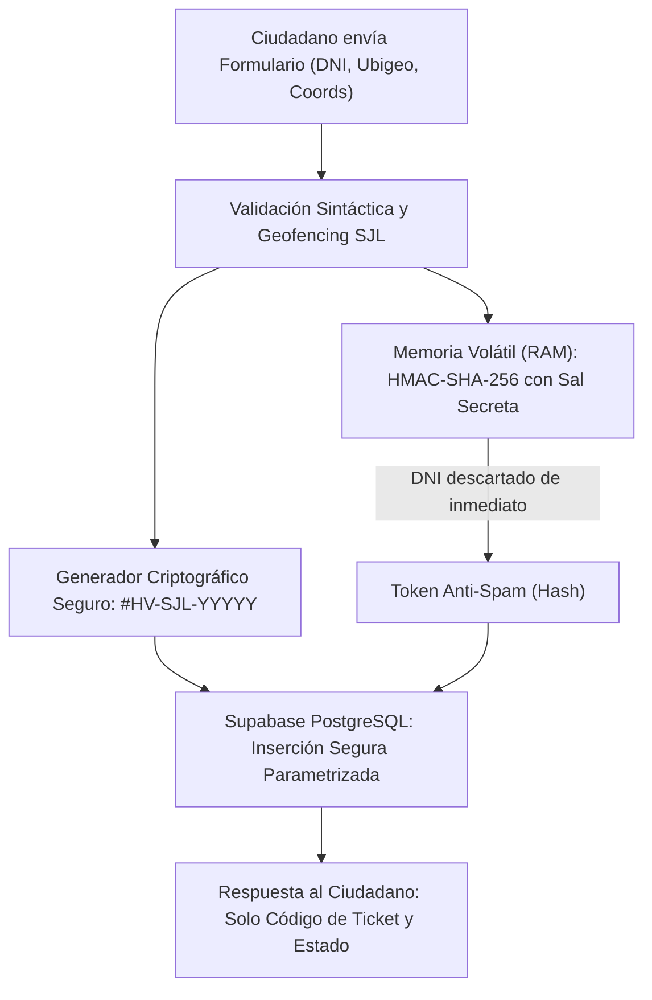

# 🧵 Hilando Voces · Plataforma de Acción Comunitaria
> **Warmi Innovathon 2026** · Eje 4: Liderazgo Comunitario (Grupo 7)  
> *San Juan de Lurigancho (SJL), Lima, Perú*

[](https://nextjs.org/)
[](https://www.typescriptlang.org/)
[](https://tailwindcss.com/)
[](https://fonts.google.com/)
[](https://supabase.com/)
[](https://ai.google.dev/)
[](https://www.minjus.gob.pe/)

---

## 📖 1. Visión y Propósito del Proyecto

En el distrito más poblado del Perú (**San Juan de Lurigancho**, con más de 1.2 millones de habitantes), las problemáticas barriales cotidianas —postes de alumbrado quemados que generan pasajes oscuros e inseguros para mujeres y jóvenes, acumulación descontrolada de residuos y parques comunitarios abandonados— suelen perderse en la burocracia institucional o generar desconfianza ciudadana por temor a represalias o filtración de datos en un contexto de extorsiones.

**Hilando Voces** transforma la queja pasiva en **liderazgo comunitario activo**, articulando a vecinas y vecinos con brigadas juveniles para autogestionar faenas barriales de rápida ejecución:
1. **Reporte Ciudadano 100% Anónimo y Seguro:** Interfaz accesible diseñada para personas mayores y jóvenes, sin contraseñas ni registros invasivos.
2. **Inteligencia Territorial y Copiloto IA:** Categorización automática y priorización con **Gemini 3.8 Flash** para orientar a las lideresas barriales.
3. **Organización de Faenas Barriales:** Generación de fichas técnicas operativas para organizar jornadas comunales con materiales, refrigerios y roles.
4. **Rendición de Cuentas Ciudadana:** Trazabilidad pública mediante comparativas fotográficas *"Antes"* y *"Después"*, cerrando el ciclo de confianza.

---

## 🛡️ 2. Arquitectura de Ciberseguridad y Privacidad

El sistema fue diseñado bajo el principio de **Privacy by Design** y en estricto cumplimiento de la **Ley N° 29733 (Ley de Protección de Datos Personales del Perú)**.

### Matriz de Mitigación de Amenazas

| Vector de Amenaza | Riesgo Identificado | Mecanismo de Mitigación Implementado |
|---|---|---|
| **Fuga de DNI / Padrón Ciudadano** | Exposición de números de identidad en BD | **HMAC-SHA-256 en memoria volátil (RAM):** El DNI nunca se almacena en disco ni en la base de datos. Se genera un hash criptográfico con sal secreta únicamente para verificación de unicidad (anti-spam) y se descarta al instante. |
| **Ataque de Enumeración / IDOR** | Extracción masiva de reportes probando códigos secuenciales (`#HV-SJL-001`, `#HV-SJL-002`) | **Códigos Criptográficos Impredecibles (`#HV-SJL-YYYYY`):** Generados con `crypto.randomBytes(5)` sobre base32 Crockford ($33,554,432$ combinaciones posibles). |
| **Exfiltración de Datos por APIs** | Fuga de números de WhatsApp o hashes en endpoints públicos | **Principio de Mínimo Privilegio:** Los endpoints públicos (`GET /api/reports`, `POST /api/reports/consult`) proyectan exclusivamente campos seguros (`ticket_code`, `axis`, `status`, `created_at`, `photo_urls`). `coordinator_whatsapp` y `anti_spam_hash` permanecen inaccesibles. |
| **Inyección SQL (SQLi)** | Inyección de payloads en consultas a base de datos | **Consultas Parametrizadas PostgREST:** Todo acceso a Supabase utiliza vinculación estricta de parámetros sin concatenación de cadenas SQL. Validadores regex (`isValidTicketCode`, `isValidDniFormat`). |
| **Cross-Site Scripting (XSS)** | Inserción de scripts maliciosos en descripciones o referencias | **Sanitización Activa:** Limpieza de tags HTML (`<... >`) y pseudo-protocolos `javascript:` antes del almacenamiento. |
| **Reportes Falsos / Spam** | Envíos automatizados masivos desde fuera de la zona | **Doble Barrera Cívico-Espacial:** Verificación de Ubigeo oficial de 6 dígitos + Geofencing espacial estricto dentro del polígono delimitado de San Juan de Lurigancho. |



---

## 🎨 3. Sistema de Diseño e Identidad Visual

Siguiendo las pautas de accesibilidad y calidez comunitaria de la iniciativa Warmi:

- **Tipografía Oficial:** **Google Sans** y **Google Sans Text** (de `fonts.google.com`), asegurando máxima legibilidad tanto en pantallas móviles como para personas adultas mayores.
- **Iconografía Oficial:** **Google Fonts Material Symbols Outlined**, integrados de forma nativa con renderizado óptico adaptativo.
- **Color Primario de Acción:** `#d30684` (Magenta Comunitario Warmi).
- **Paleta Armónica Cívica:**
  - *Mostaza Cálida (Perséfone):* `#E4981E` (Eje Alumbrado).
  - *Terracota Coral (Démeter):* `#E28A85` (Eje Limpieza de Basura).
  - *Verde Esperanza (Démeter):* `#588157` / `#F0FDF4` (Eje Espacios Recreativos).
  - *Fondo Papel Artesanal:* `#FAF8F5` (Neutro acogedor de alto contraste).

---

## 🏗️ 4. Arquitectura de Software y Capas del Proyecto

El proyecto sigue una arquitectura modular y desacoplada dentro del stack Next.js App Router:

```
hilando-voces/
├── public/
│   └── images/dni/                # Guías visuales oficiales RENIEC (DNI azul, DNIe, DNIe 2020)
├── scripts/
│   └── ahp_prioritizer.py         # Script en Python de validación matemática AHP de Saaty
├── src/
│   ├── app/
│   │   ├── layout.tsx             # Inyección de Google Sans y Material Symbols
│   │   ├── globals.css            # Tokens de diseño Warmi, reglas de Leaflet y tipografía
│   │   ├── page.tsx               # Página principal: Formulario ciudadano protagónico
│   │   ├── consultar/             # Módulo de consulta ciudadana por Ticket o DNI
│   │   ├── admin/                 # Portal Territorial de Lideresas Barriales
│   │   │   ├── layout.tsx         # Layout con Route Guard estricto y AdminSessionProvider
│   │   │   ├── login/             # Puerta de autenticación formal RBAC
│   │   │   ├── centro-mando/      # Dashboard gerencial: Mapa territorial y KPIs
│   │   │   ├── bandeja/           # Bandeja de incidencias comunales estilo correo
│   │   │   ├── calendario/        # Planificador mensual de faenas y descarga de fichas
│   │   │   ├── ahp/               # Priorización multicriterio científica AHP de Saaty
│   │   │   ├── voluntarios/       # Directorio barrial de herramientas y cuadrillas
│   │   │   ├── rendicion/         # Bitácora comunal fotográfica Antes / Después
│   │   │   └── equipo/            # Directorio de lideresas y matriz formal RBAC
│   │   └── api/
│   │       ├── reports/           # Creación y consulta territorial pública
│   │       │   └── consult/       # Recuperación de expedientes anónimos
│   │       └── admin/
│   │           ├── reports/       # Dataset enriquecido con verificación RBAC y Ley 29733
│   │           │   └── [id]/      # Actualización de estados y fotos de faena
│   │           └── chat/          # Copiloto territorial Warmicha con Gemini 2.5 Flash
│   ├── components/
│   │   ├── admin/                 # Componentes modulares del portal de lideresas
│   │   │   ├── AdminSessionContext.tsx # Contexto de sesión y persistencia local
│   │   │   ├── AdminDataContext.tsx    # Contexto unificado de reportes y mutaciones
│   │   │   ├── AdminLayoutShell.tsx    # Shell administrativa con barra lateral colapsable
│   │   │   ├── DashboardOverview.tsx   # Centro de mando territorial con mapa interactivo
│   │   │   ├── IncidentsManager.tsx    # Bandeja de casos con vista previa y triaje
│   │   │   ├── FaenasPlanner.tsx       # Calendario de jornadas comunitarias
│   │   │   ├── AHPPrioritizerView.tsx  # Matriz de consistencia AHP y ranking científico
│   │   │   ├── VolunteersDirectory.tsx # Directorio de brigadistas y enlace a WhatsApp
│   │   │   ├── AccountabilityGallery.tsx # Galería de transformación territorial
│   │   │   ├── TeamRolesManager.tsx    # Directorio de dirigentas y matriz RBAC
│   │   │   └── WarmichaChatbot.tsx     # Chatbot flotante interactivo con IA
│   │   ├── GoogleIcon.tsx         # Iconos oficiales Google Fonts Material Symbols
│   │   ├── Navbar.tsx             # Barra institucional ciudadana
│   │   ├── ReportForm.tsx         # Formulario en 4 pasos accesible para toda edad
│   │   ├── LocationPickerMap.tsx  # Selector Leaflet con geofencing de SJL
│   │   ├── TerritorialMap.tsx     # Mapa territorial de calor e incidencias
│   │   └── FaenaSheetModal.tsx    # Generador e impresor de Ficha Técnica comunal
│   ├── lib/
│   │   ├── ahp.ts                 # Algoritmo de Saaty, normalización de pesos y vector propio
│   │   ├── authGuard.ts           # Middleware defensivo de autenticación y sanitización RBAC
│   │   ├── hasher.ts              # HMAC-SHA-256 en memoria, anti-IDOR #HV-SJL-YYYYY
│   │   ├── geofencing.ts          # Ray-casting espacial sobre polígono de SJL
│   │   ├── gemini.ts              # Integración con Google Gen AI SDK
│   │   └── supabaseClient.ts      # Cliente Supabase seguro
│   └── types/
│       └── index.ts               # Tipado estricto TypeScript
```

---

## 📐 5. Priorización Científica con Modelo Multicriterio AHP (Saaty)

Para evitar la discrecionalidad o que todas las quejas se clasifiquen como "urgentes", el sistema implementa la metodología **Analytic Hierarchy Process (AHP)** desarrollada por Thomas Saaty, basada en la calibración realizada por el Grupo 7:

- **Criterios y Ponderaciones Sociales:**
  1. **Seguridad Ciudadana (48.47%):** Rutas escolares oscuras, pasajes peatonales en cerros y riesgo delictivo nocturno.
  2. **Salud Física y Mental (22.68%):** Focos infecciosos, olores fétidos y basurales frente a colegios o mercados.
  3. **Equidad Territorial (14.31%):** Asentamientos humanos en laderas altas y zonas sin cobertura municipal.
  4. **Alcance Poblacional (8.88%):** Densidad de familias y transeúntes beneficiados directamente.
  5. **Convivencia y Espacio Público (5.66%):** Revitalización de losas deportivas y parques infantiles.
- **Razón de Consistencia (CR):** $CR = 0.0221$ ($< 0.10$), lo que certifica matemáticamente la coherencia de la matriz de comparaciones pareadas.

---

## ☁️ 6. Despliegue en Producción en Vercel

La aplicación está completamente optimizada para su despliegue continuo en **Vercel**:

### Checklist de Despliegue:
1. **Conexión del Repositorio:**
   - Iniciar sesión en [Vercel](https://vercel.com).
   - Seleccionar **Add New Project** e importar el repositorio `Pexxrx/Hilando-Voces-Grupo-7`.
2. **Configuración del Proyecto:**
   - **Framework Preset:** `Next.js`
   - **Root Directory:** Seleccionar `hilando-voces`
   - **Build Command:** `npm run build` (o predeterminado de Next.js)
   - **Output Directory:** `.next`
3. **Variables de Entorno en Vercel Dashboard (`Settings -> Environment Variables`):**
   ```env
   NEXT_PUBLIC_SUPABASE_URL=https://tu-proyecto.supabase.co
   NEXT_PUBLIC_SUPABASE_ANON_KEY=tu-anon-key-de-supabase
   SUPABASE_SERVICE_ROLE_KEY=tu-service-role-key-de-supabase
   GEMINI_API_KEY=AIzaSy... (Obtenida en Google AI Studio)
   DNI_SECRET_SALT=tu-sal-criptografica-aleatoria-de-64-caracteres
   NEXT_PUBLIC_DEFAULT_UBIGEO=150132
   NEXT_PUBLIC_DEFAULT_DISTRICT=San Juan de Lurigancho
   ```
4. **Desplegar:**
   - Hacer clic en **Deploy**. Vercel compilará la aplicación y aprovisionará automáticamente el certificado SSL y el dominio HTTPS de producción (`https://tu-proyecto.vercel.app`).

---

## 👥 7. Equipo y Reconocimientos

- **Proyecto:** Hilando Voces
- **Concurso:** Warmi Innovathon 2026
- **Eje Temático:** Eje 4: Liderazgo Comunitario
- **Grupo:** Grupo 7
- **Área Geográfica Inicial:** San Juan de Lurigancho (SJL), Lima, Perú
