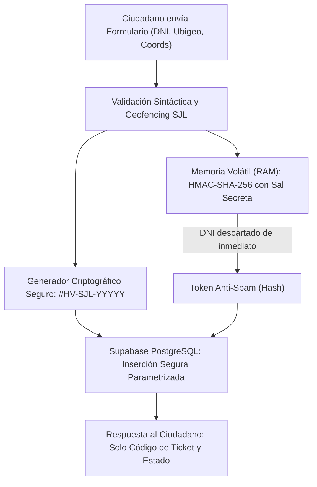

# 🧵 Hilando Voces · Plataforma de Acción Comunitaria
> **Warmi Innovathon 2026** · Eje 4: Liderazgo Comunitario (Grupo 7)  
> *San Juan de Lurigancho (SJL), Lima, Perú*

[](https://nextjs.org/)
[](https://www.typescriptlang.org/)
[](https://tailwindcss.com/)
[](https://fonts.google.com/)
[](https://supabase.com/)
[](https://ai.google.dev/)
[](https://www.minjus.gob.pe/)

---

## 📖 1. Visión y Propósito del Proyecto

En el distrito más poblado del Perú (**San Juan de Lurigancho**, con más de 1.2 millones de habitantes), las problemáticas barriales cotidianas —postes de alumbrado quemados que generan pasajes oscuros e inseguros para mujeres y jóvenes, acumulación descontrolada de residuos y parques comunitarios abandonados— suelen perderse en la burocracia institucional o generar desconfianza ciudadana por temor a represalias o filtración de datos en un contexto de extorsiones.

**Hilando Voces** transforma la queja pasiva en **liderazgo comunitario activo**, articulando a vecinas y vecinos con brigadas juveniles para autogestionar faenas barriales de rápida ejecución:
1. **Reporte Ciudadano 100% Anónimo y Seguro:** Interfaz accesible diseñada para personas mayores y jóvenes, sin contraseñas ni registros invasivos.
2. **Inteligencia Territorial y Copiloto IA:** Categorización automática y priorización con **Gemini 3.8 Flash** para orientar a las lideresas barriales.
3. **Organización de Faenas Barriales:** Generación de fichas técnicas operativas para organizar jornadas comunales con materiales, refrigerios y roles.
4. **Rendición de Cuentas Ciudadana:** Trazabilidad pública mediante comparativas fotográficas *"Antes"* y *"Después"*, cerrando el ciclo de confianza.

---

## 🛡️ 2. Arquitectura de Ciberseguridad y Privacidad

El sistema fue diseñado bajo el principio de **Privacy by Design** y en estricto cumplimiento de la **Ley N° 29733 (Ley de Protección de Datos Personales del Perú)**.

### Matriz de Mitigación de Amenazas

| Vector de Amenaza | Riesgo Identificado | Mecanismo de Mitigación Implementado |
|---|---|---|
| **Fuga de DNI / Padrón Ciudadano** | Exposición de números de identidad en BD | **HMAC-SHA-256 en memoria volátil (RAM):** El DNI nunca se almacena en disco ni en la base de datos. Se genera un hash criptográfico con sal secreta únicamente para verificación de unicidad (anti-spam) y se descarta al instante. |
| **Ataque de Enumeración / IDOR** | Extracción masiva de reportes probando códigos secuenciales (`#HV-SJL-001`, `#HV-SJL-002`) | **Códigos Criptográficos Impredecibles (`#HV-SJL-YYYYY`):** Generados con `crypto.randomBytes(5)` sobre base32 Crockford ($33,554,432$ combinaciones posibles). |
| **Exfiltración de Datos por APIs** | Fuga de números de WhatsApp o hashes en endpoints públicos | **Principio de Mínimo Privilegio:** Los endpoints públicos (`GET /api/reports`, `POST /api/reports/consult`) proyectan exclusivamente campos seguros (`ticket_code`, `axis`, `status`, `created_at`, `photo_urls`). `coordinator_whatsapp` y `anti_spam_hash` permanecen inaccesibles. |
| **Inyección SQL (SQLi)** | Inyección de payloads en consultas a base de datos | **Consultas Parametrizadas PostgREST:** Todo acceso a Supabase utiliza vinculación estricta de parámetros sin concatenación de cadenas SQL. Validadores regex (`isValidTicketCode`, `isValidDniFormat`). |
| **Cross-Site Scripting (XSS)** | Inserción de scripts maliciosos en descripciones o referencias | **Sanitización Activa:** Limpieza de tags HTML (`<... >`) y pseudo-protocolos `javascript:` antes del almacenamiento. |
| **Reportes Falsos / Spam** | Envíos automatizados masivos desde fuera de la zona | **Doble Barrera Cívico-Espacial:** Verificación de Ubigeo oficial de 6 dígitos + Geofencing espacial estricto dentro del polígono delimitado de San Juan de Lurigancho. |



---

## 🎨 3. Sistema de Diseño e Identidad Visual

Siguiendo las pautas de accesibilidad y calidez comunitaria de la iniciativa Warmi:

- **Tipografía Oficial:** **Google Sans** y **Google Sans Text** (de `fonts.google.com`), asegurando máxima legibilidad tanto en pantallas móviles como para personas adultas mayores.
- **Iconografía Oficial:** **Google Fonts Material Symbols Outlined**, integrados de forma nativa con renderizado óptico adaptativo.
- **Color Primario de Acción:** `#d30684` (Magenta Comunitario Warmi).
- **Paleta Armónica Cívica:**
  - *Mostaza Cálida (Perséfone):* `#E4981E` (Eje Alumbrado).
  - *Terracota Coral (Démeter):* `#E28A85` (Eje Limpieza de Basura).
  - *Verde Esperanza (Démeter):* `#588157` / `#F0FDF4` (Eje Espacios Recreativos).
  - *Fondo Papel Artesanal:* `#FAF8F5` (Neutro acogedor de alto contraste).

---

## 🏗️ 4. Arquitectura de Software y Capas del Proyecto

El proyecto sigue una arquitectura modular y desacoplada dentro del stack Next.js App Router:

```
hilando-voces/
├── public/
│   └── images/dni/            # Guías visuales oficiales RENIEC (DNI azul, DNIe, DNIe 2020)
├── src/
│   ├── app/
│   │   ├── layout.tsx         # Inyección de Google Sans y Material Symbols
│   │   ├── globals.css        # Variables de diseño Warmi, reglas de Leaflet y tipografía
│   │   ├── page.tsx           # Página principal: Formulario ciudadano protagónico
│   │   ├── consultar/         # Módulo de seguimiento ciudadano por Ticket o DNI
│   │   ├── admin/             # Panel de Lideresas Barriales y Asignación de Faenas
│   │   └── api/
│   │       ├── reports/       # Endpoint de creación y consulta pública territorial
│   │       │   └── consult/   # Endpoint seguro de recuperación de casos
│   │       └── admin/reports/ # Gestión de estados y rendición de cuentas
│   ├── components/
│   │   ├── GoogleIcon.tsx     # Componente nativo de Material Symbols
│   │   ├── Navbar.tsx         # Barra de navegación institucional accesible
│   │   ├── ReportForm.tsx     # Formulario en 4 pasos accesible para toda edad
│   │   ├── LocationPickerMap.tsx # Mapa selector Leaflet optimizado sin cortes
│   │   ├── TerritorialMap.tsx # Mapa de calor e incidencias distritales
│   │   ├── Timeline.tsx       # Línea de tiempo de rendición de cuentas (Antes / Después)
│   │   └── FaenaSheetModal.tsx # Generador de ficha técnica comunal imprimible
│   ├── lib/
│   │   ├── hasher.ts          # HMAC-SHA-256 en memoria, anti-IDOR #HV-SJL-YYYYY y sanitización
│   │   ├── geofencing.ts      # Verificación matemática de punto en polígono (SJL)
│   │   ├── gemini.ts          # Integración con Google Gen AI SDK (Gemini 3.8 Flash)
│   │   └── supabaseClient.ts  # Cliente cliente/servidor seguro para Supabase PostGIS
│   └── types/
│       └── index.ts           # Definiciones de tipos TypeScript rigurosas
```

---

## 🚀 5. Puesta en Marcha Local

### Prerrequisitos
- Node.js 20.x o superior
- Cuenta en Supabase (PostgreSQL)
- API Key de Google Gemini (Google AI Studio)

### Instalación

1. **Clonar el repositorio:**
   ```bash
   git clone https://github.com/Pexxrx/Hilando-Voces-Grupo-7.git
   cd Hilando-Voces-Grupo-7/hilando-voces
   ```

2. **Instalar dependencias:**
   ```bash
   npm install
   ```

3. **Configurar variables de entorno (`.env.local`):**
   ```env
   # Supabase Configuration
   NEXT_PUBLIC_SUPABASE_URL=https://your-project.supabase.co
   NEXT_PUBLIC_SUPABASE_ANON_KEY=your-anon-key
   SUPABASE_SERVICE_ROLE_KEY=your-service-role-key

   # Google Gemini Copilot
   GEMINI_API_KEY=your-gemini-api-key

   # Ciberseguridad & Privacidad (Ley 29733)
   DNI_SECRET_SALT=secret-salt-string-for-hmac-sha256
   ```

4. **Ejecutar servidor de desarrollo:**
   ```bash
   npm run dev
   ```
   Abrir [http://localhost:3000](http://localhost:3000) en el navegador.

5. **Construir para producción:**
   ```bash
   npm run build
   npm run start
   ```

---

## 👥 6. Equipo y Reconocimientos

- **Proyecto:** Hilando Voces
- **Concurso:** Warmi Innovathon 2026
- **Eje Temático:** Eje 4: Liderazgo Comunitario
- **Grupo:** Grupo 7
- **Área Geográfica Inicial:** San Juan de Lurigancho (SJL), Lima, Perú
